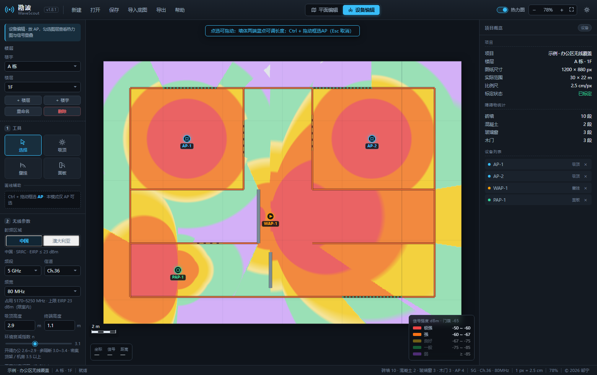
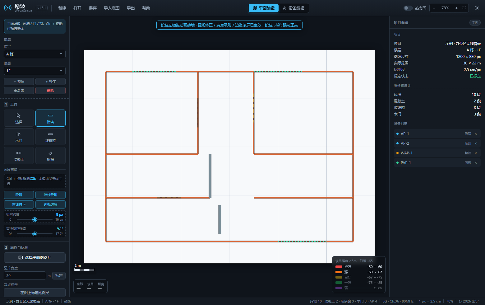
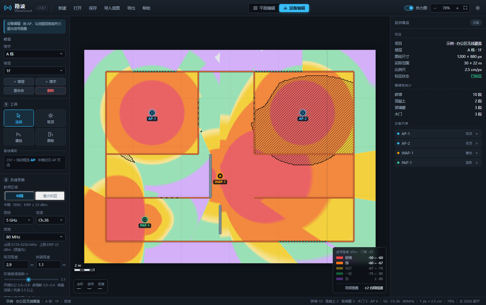

# 勘波 WaveScout

> 在建筑平面图上做 WiFi 覆盖规划：导入图纸、标定比例尺、画上墙体门窗、摆放 AP，
> 立刻看到每个位置的信号强度、盲区和覆盖率。Windows 桌面程序，本地运行，不联网，不上传图纸。


**下载** · [**使用说明**](使用说明.md) · [**作者博客**](https://xiaozou123.cn) · [**关于这个软件的完整介绍**](https://xiaozou123.cn/wavescout-wifi-coverage-planner/)



---

## 这是什么

一个跑在 Windows 上的**无线地勘 / WiFi 覆盖规划**工具。它做的事很具体：

把建筑平面图（截图、扫描件、PDF 导出的图片都行）拖进窗口 → 标一下比例尺 → 画出墙体和门窗 → 把 AP 摆上去 → 屏幕上立刻出现一张带色阶的**信号强度热力图**，外加覆盖率统计和设备清单。

用来回答方案阶段最常被问的那几个问题：

- 这个位置到底要不要再加一个 AP
- 这台放走廊还是房间里，吸顶还是壁挂
- 5G 打 80 MHz 还是 40 MHz，门限按 -65 还是 -67
- 改造前后，盲区能少多少

**它不是仿真引擎，也不能替代现场实测。** 这句话写在软件界面上，也写在这里：模型是对数距离加穿墙累加，没有射线追踪、没有多径、没有 SINR。它给的是点位与数量的判断依据，不是覆盖效果的最终结论。

## 核心能力

| 环节 | 能做什么 |
|---|---|
| 图纸与标定 | 导入 JPG / PNG / BMP / WEBP / GIF，长边超 4000 自动缩放；按图幅宽度或两点标定比例尺 |
| 墙体 | 砖墙、混凝土、玻璃窗、木门四类预设加自定义；穿透损耗可按厚度自动计算；端点 / 交点 / 墙上三级吸附，直线修正，边缘滚屏 |
| 设备 | 吸顶、壁挂、面板三种安装方式，各自的天线方向图**真实参与 RSSI 计算**；拖动圆形手柄调朝向，按住 Shift 按 15° 步进 |
| 射频 | 2.4G 支持 20 / 40 MHz，5G 支持 20 / 40 / 80 / 160 MHz；中国 SRRC 与澳洲 ACMA 一键切换，自动收紧超限功率 |
| 覆盖分析 | 五档色阶加盲区；有效覆盖面积、良好覆盖占比、弱信号占比；鼠标所在点的实时 RSSI 读数 |
| 同频重叠 | 按**频率区间相交**加双方信号强度判定同频干扰；黑框加 45° 斜线矢量轮廓，放大不糊 |
| 多楼层 | 项目 / 楼宇 / 楼层三级结构；每层独立的底图、标定与撤销栈 |
| 批量操作 | Ctrl + 拖动框选，按当前模式限制类型；批量改材质、功率、启停 |
| 导出 | 热力图 PNG（带标题、图例、比例尺）、设备清单 CSV、项目文件 JSON |
| 其他 | 撤销 100 步、Alt+1~6 切换图层、明暗主题、1.5 秒自动保存与崩溃恢复 |

## 快速开始

**下载**：到 [Releases](../../releases) 页面取最新一版的单文件 exe。

| 项 | 说明 |
|---|---|
| 系统 | Windows 10 / 11，64 位（32 位系统不支持） |
| 形态 | 单文件 exe，约 74 MB；运行时自解压到临时目录，首次启动 3~5 秒 |
| 依赖 | **不需要**安装 .NET、VC++ 运行库或任何环境，拷走就能双击 |
| 首次拦截 | 没有代码签名，Windows SmartScreen 会提示「未知发布者」，点「更多信息 → 仍要运行」即可 |
| 数据位置 | 配置与自动保存在 `%APPDATA%\WaveScout`，不写注册表；卸载就是删掉 exe 和这个目录 |

第一次打开会看到欢迎页，点**载入示例**能立刻看到一个完整的办公区样例（4 台 AP、18 段墙、406 m² 有效覆盖），先看懂效果再动手。

详细操作见 [使用说明](使用说明.md)：从导入图纸、标定比例尺到导出，一步一步都有。

## 计算模型

信号强度按这个式子算，五项各有明确口径：

```
RSSI = 发射功率 + 天线增益 + 方向图增益 − 路径损耗 − 穿墙损耗
```

| 项 | 取值方式 |
|---|---|
| 发射功率 | 射频口输出功率，室内 AP 通常 17~23 dBm |
| 天线增益 | 峰值方向增益，全向 2~5 dBi，定向 6~10 dBi |
| 方向图增益 | 按水平 / 垂直波瓣宽度、下倾角、前后比计算；垂直面按 cos 的 n 次方建模，n 由波瓣宽度反解 |
| 路径损耗 | `10·n·lg(d) + 20·lg(f) − 27.55`，室内对数距离模型 |
| 穿墙损耗 | 视线与各段墙体求交后累加，单点封顶 80 dB |

环境衰减指数 `n` 默认 2.4G 取 2.8、5G 取 3.1。**这个参数比功率更影响结果**：同一张图把 n 从 2.8 调到 3.4，三四十米外的边缘区域能多掉 10 dB 上下。

多台 AP 之间按最大值合并。同频重叠单独判定：既要两台 AP 的占用频率区间相交，也要双方在该点的信号都高于干扰阈值（默认 -67 dBm）。

### 它不做什么

| 不做的事 | 原因 |
|---|---|
| 射线追踪与多径建模 | 复杂度和计算量是另一个量级 |
| SINR 与邻频抑制 | 频宽只参与占用与重叠判定，不参与损耗计算 |
| 现场勘测 | 不读网卡、不收 RSSI 样本，是纯规划工具 |
| 人体与家具遮挡 | 模型里没有这类随机因素 |
| 云同步与协作 | 没有账号体系，数据只在本地 |

射频区域的数值是公开法规整理的参考值，**只作规划参考，不替代合规认证**，实际部署以当地最新法规为准。

## 界面

平面编辑模式：画墙、门窗，Ctrl + 拖动可框选墙体。



同频重叠图层：黑框加斜线标出会被同频干扰的区域，密度按屏幕像素恒定。



## 开发

Electron 加原生 JavaScript，**零运行时依赖**——没有 React、没有打包器、没有图表库。

```
js/core.js      数据模型 · 传播计算 · 热力图 · 重叠判定
js/render.js    Canvas 绘制
js/ui.js        交互 · 属性面板 · 项目读写
electron/       主进程与 preload（隔离上下文，CSP 只允许 self 脚本）
test/           端到端断言
build/          打包与验证脚本
```

```bash
npm install             # 首次
npm start               # 开发模式启动
npm run build           # 目录版 → dist/
npm run build:portable  # 单文件便携版 → dist-exe/
node build/e2e.js       # 端到端回归（需 Chrome）
```

测试不是「点一遍没问题」，而是 **201 条自动断言**：用真实的鼠标与键盘事件在无头浏览器里跑，跑的是打包前的同一份代码。里面包括「画水平墙撞到垂直墙时，端点吸附后 y 坐标必须与起点完全相同」这类不好写但能挡回归的用例。

## 常见问题

**Q：和那些能导入 CAD 图纸的商业软件比，差在哪？**
A：它导入的是图片（PNG / JPG / 截图 / PDF 导出的位图），不解析 DWG/DXF 矢量图纸。好处是不依赖任何设计软件，坏处是墙要自己描一遍——图越复杂，描墙花的时间越长。

**Q：算出来的结果能直接拿去施工吗？**
A：不能。它是方案阶段的估算工具，用来比几种摆法、估 AP 数量、出覆盖示意图。真要交付，仍需现场勘测和实测验证。

**Q：为什么不支持华为 / H3C / 锐捷的 AP？**
A：现在支持手动填写任意 AP 的功率、增益、波瓣宽度、前后比，所以主流厂商的设备都能算，只是参数要自己填。**一键导入主流厂商 AP 参数是下一步计划**——把天线方向图、增益、功率上限从厂商资料里直接读进来，省掉手工抄这一环。

**Q：为什么只有 Windows？**
A：打包链路只做了 Windows。核心逻辑是纯 JavaScript，理论上可以移植，但目前没有排期。

**Q：免费吗？**
A：个人项目，源码公开可读。个人学习、评估、非商业使用不收费；商业交付或二次分发请先联系作者。

## 关于作者

邹宁，广东广州，做网络工程的，这个软件是个人业余时间独立开发的。

最初是因为做方案时手边的地勘工具都不顺手——要么要原厂授权、绑着自家设备才算得准，要么界面卡、改一个点位等半天。于是自己写了一个。

- 博客：**[xiaozou123.cn](https://xiaozou123.cn)** —— IT 技术与数码极客，写工具、折腾自托管和网络
- 这个软件的完整介绍：[在平面图上算清 WiFi 覆盖与 AP 点位](https://xiaozou123.cn/wavescout-wifi-coverage-planner/)
- 有想法或发现问题：提 Issue，或到博客留言

## 许可证

**源码可见，但不是开源许可。** 详见 [LICENSE](LICENSE)。

允许：阅读、克隆、个人学习与非商业评估使用。
需要授权：商业使用、二次分发、修改后发布。
保留：著作权归作者所有。

如果你的用途需要更宽松的条款，可以联系作者单独协商。
